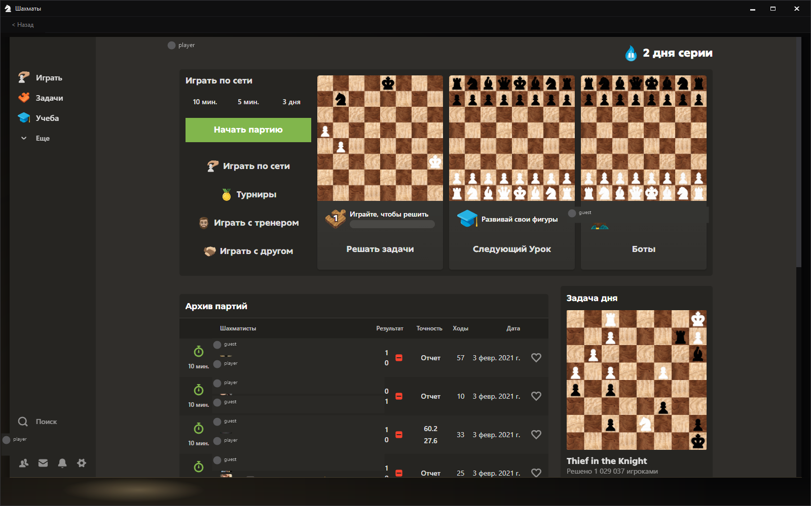
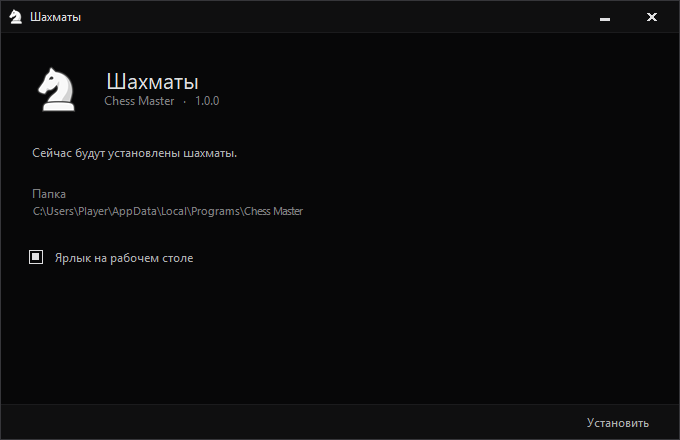

<p align="center">
  
</p>

<h1 align="center">Chess Master</h1>

<p align="center">
  A dark desktop shell for <a href="https://www.chess.com/">chess.com</a>.<br>
  The window is the app: flat black chrome, no system frame.
</p>

<p align="center">
  <a href="https://github.com/Art-Stea1th/chess_master_x/releases/tag/v1.0.2"><strong>Download 1.0.2</strong></a>
  &nbsp;·&nbsp; Windows x64
  &nbsp;·&nbsp; no administrator rights
</p>

<p align="center">
  
</p>

<p align="center">
  
</p>

## Install

Download [ChessMaster-Setup-1.0.2.exe](https://github.com/Art-Stea1th/chess_master_x/releases/download/v1.0.2/ChessMaster-Setup-1.0.2.exe) and run it.

The installer puts the app in your user profile:

`%LocalAppData%\Programs\Chess Master`

It does not ask for administrator rights. A desktop shortcut is created unless you clear the checkbox. If Chess Master is already open, the installer closes it and starts the new copy when it finishes.

.NET is inside the package. Windows 11 already includes the WebView2 runtime the shell uses to draw chess.com. On Windows 10, install [WebView2](https://developer.microsoft.com/microsoft-edge/webview2/) if the page stays blank.

## What it is

Chess Master is a small window around chess.com. The caption, the borders, and the menu tones belong to the shell. The board, the games, and the account stay on chess.com.

- Borderless window, near-black, with its own caption buttons
- chess.com loaded in WebView2
- Menu rows sit a step above the page background, and rise one more step under the pointer
- Window size and position are remembered
- Per-user install, removed from Windows settings like any other app

## Build

The shell targets .NET 10 for Windows.

```bash
dotnet build src/ChessMaster/ChessMaster.csproj -c Release
```

The installer you see above is `src/ChessMaster.Setup`. It draws the window. Inno Setup, compiled from `installer/ChessMaster-v2.iss`, only copies the files into the user profile.
